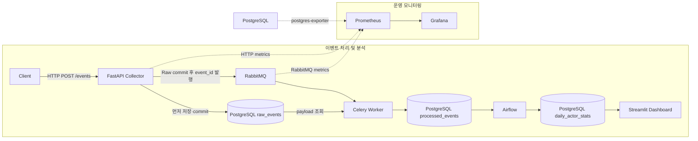

# Event Data Platform

**이벤트 생성부터 수집, 비동기 처리, 배치 집계, 분석 Dashboard와 운영 Monitoring까지 연결한 End-to-End 데이터 플랫폼입니다.**

백엔드와 데이터 파이프라인의 역할 분리, 데이터 저장 및 집계 흐름, 운영 지표 수집을 실제 실행 가능한 구성으로 구현한 포트폴리오 프로젝트입니다. 운동·휴식 이벤트는 플랫폼을 검증하기 위한 **sample domain**이며, 운동 서비스 자체가 프로젝트의 목적은 아닙니다.

## Architecture



세 application 테이블은 같은 PostgreSQL application DB에 있습니다. Airflow metadata는 같은 PostgreSQL 서버의 별도 `airflow` DB에 저장합니다. 세 Compose 구성은 공통 Docker network로 연결됩니다.

## Key Design Decisions

| 설계 선택 | 구현 의도 |
| --- | --- |
| **Raw First** | 구조화 처리 전에 이벤트 payload를 JSONB로 저장합니다. 후처리 결과와 수집 데이터를 구분합니다. |
| **수집과 후처리 분리** | Collector는 Raw 저장 후 작업을 발행하고, 필드 추출·Processed 저장은 Worker가 수행합니다. |
| **Collector async DB / Worker sync DB** | FastAPI는 SQLAlchemy AsyncSession·asyncpg, Celery Worker는 동기 Session·psycopg를 사용합니다. |
| **Celery와 Airflow 역할 분리** | Celery는 이벤트 한 건의 비동기 처리, Airflow는 스케줄 기반 집계를 담당합니다. Airflow는 LocalExecutor를 사용합니다. |
| **분석과 운영 화면 분리** | Streamlit은 Data Mart의 분석 결과, Grafana는 서비스와 인프라의 운영 지표를 보여 줍니다. |
| **Alembic schema migration** | application 테이블 생성은 Collector 시작 시 `alembic upgrade head`로 관리합니다. |

Collector, Worker, Alembic, Dashboard, Airflow의 application DB 연결은 공통 `POSTGRES_*` 환경변수를 사용합니다.

## Event Processing Flow

1. Client가 샘플 사용자별로 운동·휴식 이벤트를 생성하고 Collector에 전송합니다.
2. Collector가 필수 필드와 timezone을 포함한 timestamp를 검증합니다. 유효하지 않은 입력은 `422`로 응답합니다.
3. 검증된 payload와 원래 timestamp 문자열을 `raw_events`에 `PENDING` 상태로 저장하고 commit합니다.
4. RabbitMQ에는 payload 전체 대신 **`event_id`만 전달**합니다. 신규 이벤트 응답은 `202 accepted`입니다.
5. Worker가 Raw를 조회하고 상태를 `PROCESSING`으로 변경합니다.
6. `processed_events`에 사용자 ID·이름, 행동, 대상, 속성, 이벤트 시각을 구조화하여 저장합니다.
7. 처리가 완료되면 Raw 상태를 `COMPLETED`로 변경합니다.

```text
PENDING → PROCESSING → COMPLETED
```

동일한 `event_id`가 다시 들어오면 `200 duplicate`로 응답합니다. 기존 payload를 덮어쓰거나 Celery 작업을 다시 발행하지 않습니다. 이 처리는 수집 요청의 중복 방어이며, Worker 장애 복구 전체를 보장하는 기능은 아닙니다.

## Data Pipeline

Airflow의 `daily_actor_stats` DAG는 **2분마다 실행**하며, 각 실행의 `data_interval_start`가 속한 **UTC 날짜 전체**를 집계합니다. 2분 구간의 이벤트만 집계하는 방식은 아닙니다.

- 집계 대상: `processed_events`의 이벤트 시각
- 날짜 범위: 해당 UTC 날짜의 00:00 이상, 다음 날 00:00 미만
- Data Mart 컬럼: `stat_date`, `actor_id`, `actor_name`, `event_count`
- 기본 키: `(stat_date, actor_id)`
- 사용자 이름: 해당 날짜의 최신 이벤트에 기록된 이름
- 저장 방식: 같은 기본 키에 대해 집계 결과를 upsert

실행 시점의 `CURRENT_DATE` 대신 Airflow 실행에 연결된 날짜를 사용하므로, 과거 실행을 다시 수행하면 그 날짜를 재집계할 수 있습니다. 반복 실행은 이벤트 수를 누적하지 않고 다시 계산한 값으로 갱신합니다.

`catchup=False`이며 과거 날짜를 자동으로 계속 재집계하지는 않습니다. 지연 도착한 과거 이벤트는 해당 날짜의 실행을 다시 수행해야 반영됩니다.

## Dashboard

Streamlit은 `daily_actor_stats`를 조회하여 다음을 표시합니다.

- **Total Events**: Data Mart에 집계된 이벤트 수의 합계
- **Active Actors**: Data Mart에 포함된 고유 사용자 ID 수
- **Events by Actor**: 사용자 이름별 이벤트 수 합계
- **Daily Event Trend**: 날짜별 이벤트 수 합계
- **Daily Actor Stats**: Data Mart 테이블

화면 수치는 마지막 Airflow 집계 결과를 기준으로 하며, Raw·Processed 테이블의 실시간 건수와 차이가 날 수 있습니다. 데이터 조회는 Streamlit 앱 실행·재실행 시 이루어집니다.

## Monitoring

Prometheus가 Collector의 HTTP metrics, PostgreSQL exporter, RabbitMQ metrics를 수집합니다. Grafana의 **Event Data Platform Operations** dashboard에는 다음 6개 패널이 있습니다.

| 대상 | 패널 |
| --- | --- |
| Collector | RPS, Latency(mean·p95) |
| PostgreSQL | Connections, Transactions(commit·rollback rate) |
| RabbitMQ | Queue Messages(ready·unacked·total), Consumers |

Collector 패널은 `POST /events`를 기준으로 합니다. PostgreSQL 패널은 application DB와 Airflow metadata DB를 DB별로 표시하며, RabbitMQ 패널은 broker 전체 합계입니다.

Prometheus datasource와 dashboard는 **Grafana provisioning**으로 자동 등록합니다. Grafana의 named volume은 로컬 설정을 보존하고, provisioning 파일은 새 환경에서 같은 운영 화면을 복원합니다.

## Tech Stack

| 영역 | 사용 기술 |
| --- | --- |
| Client | Python, asyncio, HTTPX |
| Collector | FastAPI, Uvicorn, Pydantic |
| 데이터 저장·접근 | PostgreSQL, SQLAlchemy, asyncpg, psycopg, psycopg2 |
| 비동기 처리 | RabbitMQ, Celery |
| 스케줄 집계 | Apache Airflow, PostgreSQL provider, SQL |
| 분석 화면 | Streamlit, pandas |
| 운영 모니터링 | Prometheus, Grafana, postgres-exporter, prometheus-fastapi-instrumentator |
| schema·실행 관리 | Alembic, Docker, Docker Compose, Makefile |

## Project Structure

```text
event-data-platform/
├── client/                         # 샘플 이벤트 생성·전송
│   └── sample_data/                # 샘플 사용자·운동 데이터
├── collector/                      # 수집 API·Celery 작업·DB 접근
│   ├── alembic/                    # application schema migration
│   ├── database.py                 # Collector 비동기 DB 연결
│   └── worker_database.py          # Worker 동기 DB 연결
├── db/init/                        # Airflow metadata DB 초기 생성
├── pipeline/
│   ├── dags/daily_actor_stats.py   # UTC 날짜별 사용자 집계
│   └── docker-compose.yml          # Airflow init·scheduler·webserver
├── dashboard/                      # Streamlit 분석 화면
├── monitoring/
│   ├── dashboards/                 # Grafana dashboard JSON
│   ├── provisioning/               # datasource·dashboard 자동 등록
│   ├── prometheus.yml              # metrics 수집 대상
│   └── docker-compose.yml          # Prometheus·Grafana·exporter
├── tests/                          # 입력·중복·집계·provisioning 검증
├── .env.example
├── docker-compose.yml              # Client·Collector·Worker·DB·RabbitMQ·Dashboard
├── Makefile
└── README.md
```

## Getting Started

Docker Engine/Docker Desktop, Docker Compose, `curl`을 준비하고 저장소 루트에서 실행합니다. Makefile 명령을 사용하려면 `make`도 필요합니다. 기본 서비스 포트가 다른 프로그램에 사용되고 있지 않아야 합니다.

### 1. 환경변수 준비

```bash
cp .env.example .env
```

`.env.example`의 값은 로컬 데모용 예시입니다. 필요에 맞게 `.env`를 수정하며 실제 자격증명을 저장소에 올리지 않습니다.

| 변수 | 역할 |
| --- | --- |
| `COLLECTOR_URL` | Client가 전송할 Collector 주소. Compose 내부 기본값은 `http://collector:8000/events` |
| `EVENT_INTERVAL` | 샘플 사용자별 이벤트 생성 간격(초) |
| `POSTGRES_DB` | 모든 application 서비스가 사용하는 DB 이름 |
| `POSTGRES_USER` | PostgreSQL 사용자 |
| `POSTGRES_PASSWORD` | PostgreSQL 비밀번호 |

`DATABASE_URL`은 사용하지 않습니다. Airflow·exporter가 연결 URI에 자격증명을 삽입하므로 현재 구성에서는 URL-safe 값을 사용합니다. Airflow metadata DB 이름은 `airflow`이므로 application DB와 구분합니다.

### 2. 이미지 빌드 및 준비

Fresh environment 검증에서는 캐시 없이 다음 빌드를 수행했습니다.

```bash
docker compose build --no-cache --pull
docker compose --env-file .env -f pipeline/docker-compose.yml build --no-cache --pull

docker compose pull db rabbitmq
docker compose --env-file .env -f monitoring/docker-compose.yml pull
```

### 3. PostgreSQL / RabbitMQ 시작

```bash
docker compose up -d --wait db rabbitmq
docker compose exec -T rabbitmq rabbitmq-diagnostics -q check_running
```

새 PostgreSQL volume에서는 application DB와 `db/init`의 Airflow DB 초기화가 실행됩니다.

### 4. Collector 시작 및 준비 확인

```bash
docker compose up -d collector

curl --fail --retry 20 --retry-connrefused --retry-delay 1 \
  http://localhost:8000/openapi.json > /dev/null

docker compose exec -T collector alembic current
```

Collector는 migration 성공 후 API를 시작합니다. `alembic current`에서 head를 확인합니다.

### 5. Worker / Client / Dashboard 시작

```bash
docker compose up -d worker client dashboard
```

Client가 샘플 이벤트를 지속적으로 생성합니다. Airflow의 첫 집계 전에는 Data Mart가 비어 있습니다.

### 6. Airflow / Monitoring 시작 및 DAG 활성화

```bash
docker compose --env-file .env -f pipeline/docker-compose.yml up -d
docker compose --env-file .env -f monitoring/docker-compose.yml up -d

docker compose --env-file .env -f pipeline/docker-compose.yml \
  exec -T airflow-scheduler airflow dags list

docker compose --env-file .env -f pipeline/docker-compose.yml \
  exec -T airflow-scheduler airflow dags unpause daily_actor_stats
```

Airflow 초기화 완료 후 scheduler·webserver가 시작됩니다. 새 환경의 DAG는 기본적으로 paused이므로 활성화가 필요합니다. `start_date`는 `2026-10-07` UTC이며, 활성화 후 다음 2분 스케줄의 집계 결과를 확인합니다. Streamlit 화면을 새로고침하면 집계 데이터를 조회합니다.

### 접속 주소 및 실행 관리

| 서비스 | 주소 | 로컬 초기 계정 |
| --- | --- | --- |
| Collector API 문서 | [http://localhost:8000/docs](http://localhost:8000/docs) | — |
| Airflow | [http://localhost:8080](http://localhost:8080) | `admin` / `admin` |
| Streamlit Dashboard | [http://localhost:8501](http://localhost:8501) | — |
| Prometheus targets | [http://localhost:9090/targets](http://localhost:9090/targets) | — |
| Grafana | [http://localhost:3000](http://localhost:3000) | 새 volume 기준 `admin` / `admin` |
| RabbitMQ 관리 화면 | [http://localhost:15672](http://localhost:15672) | `guest` / `guest` |

Grafana의 **Event Data Platform** 폴더에서 **Event Data Platform Operations**를 엽니다. PostgreSQL은 호스트의 `5432` 포트로 노출됩니다. 위 계정은 로컬 데모 구성 기준입니다.

```bash
make ps      # 세 Compose 구성의 컨테이너 상태
make logs    # core 서비스 로그
make down    # monitoring → pipeline → core 순서로 종료
```

일반 `make down`은 PostgreSQL·Grafana named volume을 삭제하지 않습니다. 기존 volume의 데이터와 DB 자격증명은 `.env` 변경만으로 초기화되지 않습니다.

## Verification

기존 개발 환경과 분리된 Compose 프로젝트·네트워크·새 volume에서 `.env.example`과 저장소의 Dockerfile/Compose만으로 재현을 검증했습니다. 포트 충돌을 피하기 위한 임시 override만 사용했습니다.

- 전체 애플리케이션 이미지의 캐시 없는 빌드
- 새 PostgreSQL 초기화, Alembic head 및 application schema 확인
- Client → Raw 저장 → RabbitMQ 대기 → Worker → Processed 전달 확인
- Airflow DAG 로딩·활성화 및 정기·수동 실행 성공
- 이벤트 생성 중지 후 Raw·Processed·Data Mart 합계 일치 확인
- Streamlit 지표·테이블·차트 및 주요 HTTP endpoint 확인
- Prometheus 수집 대상 `UP`, Grafana datasource·6개 패널 자동 복원 및 실제 쿼리 결과 확인

검증 데이터는 일회성 샘플이며 처리량·지연 성능 benchmark가 아닙니다. 검증 후 임시 리소스를 정리하고 기존 개발 데이터가 보존된 것도 확인했습니다.

세부 검증 스크립트는 실행 중인 기본 Compose 환경에서 다음과 같이 사용할 수 있습니다. Grafana 검증에는 호스트의 Python 3가 필요합니다.

```bash
docker compose exec -T collector python < tests/collector_checks.py

docker compose --env-file .env -f pipeline/docker-compose.yml \
  exec -T airflow-scheduler python < tests/aggregation_checks.py

python3 tests/grafana_checks.py
```

## Current Scope / Future Improvements

이 프로젝트는 백엔드·데이터 파이프라인·운영 구조를 보여 주기 위한 **로컬 실행 중심의 포트폴리오 프로젝트**입니다. production-ready 서비스로서의 신뢰성을 보장하지 않습니다.

| 현재 구현 범위 | 현재 구현하지 않은 범위 |
| --- | --- |
| Raw 우선 저장, 이벤트 단위 비동기 후처리 | Raw commit과 큐 발행을 원자적으로 연결하는 outbox |
| Collector 입력 검증·중복 요청 방어 | Worker의 명시적 retry·DLQ 및 장애 시 자동 복구 |
| 실행 날짜 기반 재집계·upsert | 지연 이벤트의 자동 과거 재집계 |
| 분석 Dashboard·운영 metrics·Grafana provisioning | 모든 운영 데이터·로그의 보존 정책 |
| Docker Compose 실행·fresh 환경 재현 검증 | 모든 서비스의 준비 상태를 자동으로 기다리는 기동 구성 |

Raw 저장 후 큐 발행이 실패하면 Raw가 남을 수 있고, Worker의 중간 실패 시 상태가 `PROCESSING`에 머물 수 있습니다. 중복 수집 응답은 이런 실패의 복구 수단이 아닙니다.

향후 개선 후보는 의존성·이미지 버전 고정, 서비스 준비 상태 점검, Dashboard의 pandas 연결 방식·Streamlit 폐기 예정 API 경고 해소입니다. retry/DLQ/outbox와 자동 과거 재집계는 실제 운영 요구가 생길 때 별도 범위로 검토합니다.
